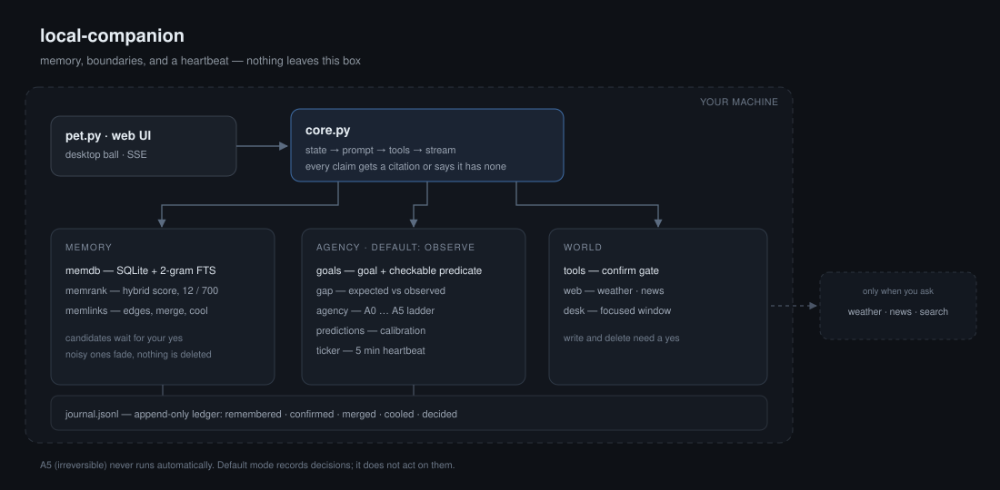

# local-companion

**Turn a local LLM into someone who lives on your machine.**

*中文版：[README.md](README.md)*

Not a chat UI. Five things:

| | |
|---|---|
| **Remembers** | A memory only counts after you approve it; rejected ones never come back. Near-duplicates merge, stale ones cool down, contradictions are shown to you instead of being auto-resolved. |
| **Speaks first** | Morning, long sitting, late night, long absence, and *your thing is coming up*. Daily cap, quiet hours, silence by default. |
| **Reads the room** | Chat / comfort / work / urgent — four modes decide tone, length, and whether joking is allowed. |
| **Knows its limits** | File writes and deletes need confirmation. The gate is in code, not in the prompt. If it can't cite something, it says so. No body, no pretending. |
| **Thinks a little on its own** | Goals are objects, gaps trigger, actions have five levels. Default is **observe only** — acting is something you turn on in config. |

> No account. No server. No telemetry. Your model, your files, your disk —
> deleting `memory/` is the same as it never existing.

**For you if** you'll spend half an hour setting up a model, care that your data stays put, and can't stand customer-support voice.
**Not for you if** you want a hosted web app, multi-device sync, or a plugin marketplace.



## Requirements

| | |
|---|---|
| OS | Windows 10 / 11 (macOS and Linux run the core and web UI; window sensing is Win32-only) |
| Python | 3.9+, **check "Add Python to PATH"** during install |
| Model | One GGUF file; an 8B Q4 quant is ~4.7 GB |
| VRAM | 6 GB to start; smaller model or CPU-only works too (slow) |
| Dependencies | **None.** Standard library + tkinter only |

## Quickstart

```powershell
# 1. model server (keep this window open)
llama-server -m your-model.gguf --port 8081 --jinja -np 1 -c 8192 -ngl 99

# 2. config (first run asks four questions)
copy runtime\config.example.json runtime\config.json

# 3. run
python runtime\core.py     # web UI: http://127.0.0.1:7860
python runtime\pet.py      # desktop ball (optional)
```

On Windows just double-click `start.bat` — it checks Python, writes the config, asks for a
name, and starts both. Inference runs on llama.cpp; any OpenAI-compatible endpoint works.

## How it differs

| | Usual approach | Here |
|---|---|---|
| Where memory lives | Cloud account / vector DB service | SQLite on your disk — `sqlite3 memory/zero.db ".dump"` takes all of it |
| What gets remembered | The model decides | Candidates plus your approval; rejected ones are blacklisted |
| Does memory rot | It just grows | Merge, cool, archive, report conflicts — **cooled, never deleted** |
| How memory is used | Dump everything into context | Hybrid score + de-duplication, fixed budget of 12 items / 700 chars |
| Will it act on its own | Agreed in the prompt | Actions A0–A5; irreversible ones are locked in code |
| Debugging a decision | Grep the logs | `journal.jsonl` is an append-only ledger; every action carries a reason and a level |

To be blunt: this does not give a model a soul. It makes *remembering*, *having manners*,
and *not overstepping* into structure. The rest is rapport.

## How memory is picked

Every turn re-ranks instead of taking the first N rows:

```
score = semantic × 0.45 + lexical × 0.25 + recency × 0.15 + usage × 0.05 + importance × 0.10
```

- **Budget**: 12 items / 700 characters, whichever runs out first. Injection size does not
  grow with the size of the store.
- **De-duplication**: from the second pick on, items too similar to what's already chosen
  are penalised — so twelve lines don't say the same thing.
- **Pinned** items always go in; they skip ranking.
- **Cooling**: items that stop being recalled decay in weight. They are never deleted.
- **Chinese retrieval**: the index stores character 2-grams, not raw text. SQLite's default
  tokenizer treats a run of CJK as one token, so searching 上海 would never match 我住在上海.

Without an embedding model, semantic score is 0 and everything else still works. The index
can be rebuilt; a broken index falls back to lexical matching rather than losing memories.

Once a day, an idle job merges near-duplicates, cools cold items, archives the very old,
and surfaces contradictions — it reports them, it does not decide for you.

## Agency is off by default

`agency_mode` has four settings:

| Mode | Behaviour |
|---|---|
| `off` | Heartbeat does not even run |
| `observe` **(default)** | Computes gaps, logs decisions, may prepare reversible material. Does not speak or act |
| `propose` | May present a plan and wait for your yes |
| `act` | May perform reversible actions inside a whitelist |

Action levels: **A0** observe · **A1** prepare · **A2** report when you're present ·
**A3** propose · **A4** reversible action (whitelisted) · **A5** irreversible (sending
messages, deleting, paying) — **A5 never runs automatically, in any mode.**

Run in `observe` for a while, check `/api/agency`, and only then consider widening it.
Granting permissions before you've measured how accurate its judgement is means using your
real environment as a test bed.

## What it will not do

- Upload anything. The only outbound calls are weather/news/search that you ask for.
- Remember things you didn't approve.
- Pretend to have a body, or claim a source it doesn't have.
- Touch your files without a confirmation, or act irreversibly at all.

## Where data lives

| File | What |
|---|---|
| `memory/zero.db` | Memory store: items, index, edges, retrieval traces |
| `memory/memories.json` | Plain-text projection (export / downgrade path) |
| `memory/journal.jsonl` | Append-only ledger of remember/confirm/forget/merge |
| `memory/agency.db` | Goals, predictions, action audit, budgets |
| `memory/conversations.jsonl` | Last ~6 hours of dialogue |
| `memory/reminders.json` | Reminders |
| `runtime/personality.md` | Who it is (yours; not in the repo) |
| `runtime/config.json` | Settings |

Backup = copy `memory/` and `runtime/personality.md`.

## A note on language

Code, comments, prompts and the main README are in Chinese — this project was written for a
single Chinese-speaking user first. This file is the English entry point; if you want to
contribute English docs, that's genuinely useful.

## License

MIT. Use it, change it, sell it; just don't claim you wrote it.
